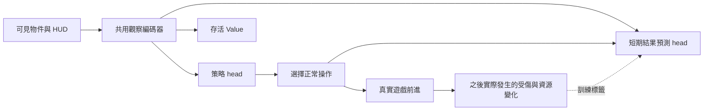

# 香蕉踩香蕉 AI 訓練評估與改進方向

日期：2026-10-25。範圍：桌機「蕉片崛起」60 秒生存，不含魔王戰。狀態：研究與設計評估，**尚未採納或實作下列方案**。

## 1 結論與建議決策

目前不能判定 PPO 或物件 Attention 不適合這個遊戲。更明確的問題是：我們尚未建立能分離「操作介面、資料分布、學習訊號、模型架構」影響的實驗方法，卻持續同時改動它們。最近的方向評分網路確實得到較差成績，但不能據此宣判區域表徵無效。

**建議先凍結模型擴張，修正實驗基準，再處理短時間避險控制。** 保留正式遊戲、碰撞、可見資訊限制、Replay 與無畫面模擬；下一輪不宜直接再加一層 Attention、GRU，或繼續同設定跑 100 代。

最接近我們需求的參考分成兩個層面：

- **任務最接近：Talakat 的彈幕避險代理。** 它把即時存活與較空曠的未來位置分開考慮，且實驗直接顯示操作重複時間會影響可完成的彈幕。但它會用模擬搜尋，不能照搬成符合我們資訊限制的 NN。見第 3 節。
- **有成功結果、又最接近「學會預測幾秒後後果」：Doom 的 Direct Future Prediction（DFP）。** 從自身實際經驗學習動作後的血量、資源等變化，推論時不需要遊戲引擎試走。它是值得評估的學習方向，但不建議立刻整套取代 PPO。見第 3、6 節。

建議路線：**公平基準與微型場景 → 操作週期與課程對照 → 簡單模型基線 → 視診斷結果加入短期結果預測或示範學習。** 每一階段有可否決的假說，避免下一個更複雜的模型又只能靠看 Replay 猜原因。

## 2 目前實驗實際告訴我們什麼

### 2.1 成績下降，但比較條件不一致

以下取自本機各 run 的 `best.json`、`test.json`。選模使用 16 場 validation，表中測試為另外 16 場從開局開始的成績；不是挑一場最好看的 Replay。

| 實驗 | 初始條件 | validation 選定代數 | 測試平均存活 | 測試過關率 |
| --- | --- | ---: | ---: | ---: |
| 物件 Attention | 從既有物件模型第 151 代 warm-start，再跑 100 代 | 50 | 37.63 秒 | 0/16 |
| 九宮格加地圖邊界 | 從隨機權重跑 100 代，當時課程為三組 | 100 | 32.46 秒 | 0/16 |
| 九宮格加 HP2 終局課程 | 從上一列第 100 代 warm-start，再跑 100 代 | 2 | 35.36 秒 | 0/16 |
| 區域直接評分移動與閃避 | 從隨機權重跑 100 代，開局／終局各半 | 80 | 27.69 秒 | 0/16 |

這些 run 的遊戲來源雜湊相同，但模型的既有訓練量、課程、實作版本不同。單一訓練 seed 也不足以分離隨機變異。表格支持「這批結果下降」，不支持「直接方向評分必然比原架構差」。

最新 run 的 100 代包含初代只評估，實際更新 99 代；收集約 **309,364 次技能決策、5,616,871 個物理步**。物理步不是獨立 NN 決策，也不能直接拿來與其他論文的 timestep 比較。以相同「100 代」比較不同決策週期、暖啟動和架構，會混淆資料與計算預算。

### 2.2 已確認的資料與行為現象

| 現象 | 實際證據 | 能得出的結論 |
| --- | --- | --- |
| 終局資料非常集中 | 新 run 的突破基準為 58.067 秒；100 代未刷新。終局池始終是同一場的 50.067～54.067 秒五個快照 | 一半 loss 權重集中在高度相關盤面；不能視為五種獨立情境 |
| 中段資料偏少 | 最新一代 3098 筆中，0～30 秒 1394、30～50 秒 146、50～60 秒 1558 | 約 4.7% 決策落在中段；這是資料分布問題，不是物件數量問題 |
| 合成對照有固定方向偏好 | 第 80 代在左側敵群與右側敵群場景中，往左三個方向的合計機率分別為 79.84%、80.52% | 在這組診斷中，沒有展現預期的左右威脅辨識；不代表所有真實盤面都如此 |
| 許多傷害發生在跳踩中 | 最後 20 代快評共 400 次損血，124 次在 stomp；前一批為 56/400 | 應檢查技能選擇與執行期間的避險。**尚不能稱 stomp 每秒風險上升**，因為欠缺動作暴露時間分母 |
| 基本更新仍有作用 | 最新代整批 KL 約 0.0148，critic 更新後 MAE 約 3.08 秒、explained variance 約 0.788 | 未看到數值崩潰；這不證明 PPO 所有設計正確，也不證明 critic 懂方向風險 |

五個終局盤面的位置集中在地圖左下附近，部分在邊界；「方向偏好可能來自課程過度集中」是合理假說，**尚未有對照實驗證明因果**。前一輪建議的「每個 seed 各留最佳紀錄」能改善多樣性，但仍可能只留下少數幸運或極端盤面，不應把它當成完整解法。

此外，critic 只憑剩餘時間與 HP，就可能解釋大量存活秒數差異。應增加「只讀時間／HP 的簡單預測器」作比較，並分時間、HP、威脅類型檢查誤差；整體 explained variance 高，不等於知道向哪裡逃。

### 2.3 現有 rule-based 成績不是公平基準

儲存的四場 rule-based 成績為 50.68、56.78、60、60 秒，平均 **56.87 秒**。不動約 12.65 秒，隨機技能約 19.88 秒。

但原規則策略直接讀全場 `observation`，選取牛奶瓶與敵人時未套 NN 的 viewport 過濾；`ruleSlicePose` 還讀取飛行起終點與進度預測未來位置。它每 0.1 秒決策，並使用連續方向及自己的避障邏輯；NN 的選擇則可能維持 0.5 秒。

因此它是「遊戲可解的工程參考」，不是相同資訊、相同操作介面的基準，更不是嚴格的性能上界。不能直接要求 NN 在較少資訊、更慢改選的條件下追平它。

應新增兩條獨立基準：

1. **同觀察規則策略**：只用 NN 可見位置、估計速度、HUD 與歷史，不讀軌跡端點或畫面外物件。
2. **同觀察、同動作介面的規則策略**：進一步使用與 NN 相同的合法輸入與決策週期，量測動作介面本身的損失。

兩者都是實驗對照，不自動嵌入 NN 控制器替它閃避。

## 3 外部成功案例與適配性

### 3.1 Talakat 的彈幕 A-star 代理

[原論文，2018，§4.4 與實驗](https://arxiv.org/pdf/1806.04718) 使用 A-star 代理評估生成彈幕。啟發式同時考慮存活進度、死亡、原地短期安全及往較少子彈區域的距離；藉由限制搜尋時間與強制重複操作，分別調整策略能力及操作靈活度。

**可借鑑：** 空間密度、短期碰撞與操作頻率應分開測量。**不可直接借用：** 它依賴環境模擬搜尋；我們已要求決策不能偷跑遊戲引擎。若做規則對照，只能以可見速度進行有誤差的幾何預測。它的成功範圍是生成關卡的評估代理，不等於完整商業彈幕遊戲通關。

### 3.2 Doom 的 Direct Future Prediction

[作者論文，ICLR 2017，§3、§4、Appendix](https://vladlen.info/papers/learning-to-act.pdf) 的 DFP 用觀察、當前量測和目標，預測候選動作之後的量測變化，以實際遊玩結果作監督標籤。模型曾贏得 Visual Doom AI Competition 的 Full Deathmatch 項目。其實驗每四個 Doom frame 選一次動作，約 114 毫秒。

**可借鑑：** 學「這個動作之後可能掉多少血、獲得多少資源」，比要求 latent vector 自然變成風險地圖更可診斷；推論可不使用引擎搜尋。**差異：** Doom 的目標與動作、資訊、訓練預算均不同，不能把競賽結果當成香蕉關保證。完整 DFP 也要處理後續策略與資料分布變化。

### 3.3 物件關係 Attention 的成功案例

[Relational Deep Reinforcement Learning，2018](https://arxiv.org/pdf/1806.01830) 在 Box-World 與 StarCraft II mini-games 用 self-attention 學物件關係；六個 mini-game 達當時最佳成績，四個超過所比較的人類 grandmaster 成績。

**可借鑑：** 共用物件編碼與關係推理有實證基礎，保留我們的物件觀察是合理方向。**限制：** 論文也指出 RL 方法、訓練時間、調參與動作選擇一起影響結果；這不是「只要放 Attention 就會懂局勢」的證明。它們先用可獨立測試的 mini-games 驗證能力，尤其值得借鑑。

### 3.4 Atari 與 PPO 的控制基線

[Playing Atari with Deep Reinforcement Learning，2013](https://arxiv.org/abs/1312.5602) 證明可以從視覺輸入學習遊戲操作；[PPO 原論文，2017](https://arxiv.org/pdf/1707.06347) 包含 Atari 實驗，使用政策比率裁切與多輪 minibatch 更新。

**可借鑑：** 短而規律的操作介面是合理基線；不必先設計一套完整「追敵、跳踩、取物」語意技能，才可能學到玩法。**限制：** 換成低階輸入會增加決策數與探索難度，論文沒有證明在我們的 CPU 預算內一定勝過技能。

### 3.5 Quake III 的長短期能力

[DeepMind 的 FTW 研究，2019](https://deepmind.google/blog/capture-the-flag-the-emergence-of-complex-cooperative-agents/) 展示多人 FPS 的人類水準合作能力。[論文](https://arxiv.org/abs/1807.01281) 結合人口式訓練與時間層級等設計。

它說明長期意圖與短期控制可以共存，但多代理與大規模訓練離我們較遠。**不列為第一個要複製的架構，也不把加 GRU 當成目前避彈問題的答案。**

### 3.6 題材相近但證據不足的開源專案

[LunAI](https://github.com/Tweet-META/LunAI) 提供多尺度觀察、PPO、短期碰撞圖與消融實驗入口，可參考資料表示與實驗工具；本次未核實可重現的獨立成功基準，故不據此宣稱 CNN/PCCM 勝過我們。另 [thrl](https://github.com/touhourl/thrl) 的 README 明確說明訓練實驗受算力限制、效果未知，不能列作成功案例。

**沒有找到同時具備「俯視生存＋高度跳踩＋爭奪資源＋可見資訊限制＋低 CPU 預算」且已驗證的完整現成方案。** 最合理的是借用已成功的子問題解法，再做本遊戲對照，而非挑一個名稱整套重寫。

## 4 對目前設計的重新檢討

### 4.1 可能最先卡住的是反應能力

目前控制器每 0.1 秒更新追蹤方向，但這不等於 NN 每 0.1 秒能重新選擇。NN 一次 move 通常 0.3 秒，其他技能可到 0.5 秒才改選；受傷或完成可能提早返回。追敵控制器會持續朝目標走，並不替它閃新威脅。

以目前程式數值做尺度估算：牛奶彈速 240，0.5 秒前進 120；飛射蕉片通常按 460 的路程速度設定，0.5 秒可達約 230，短距離受最小飛行時間影響。這不是完整碰撞推算，但足以要求測試：**危險從可辨識到碰撞的剩餘時間，是否常短於下一次可改選時間？**

診斷應在損血事件加上：上次 NN 決策後過了多久、當時是否合法可轉向、最近可見威脅的估計到達時間、同一段期間是否仍在自動追目標。先量測，再做 0.5／0.2／0.1 秒的改選對照。降低週期不等於加無敵或降低遊戲難度。

### 4.2 技能介面減少探索，也限制了控制

「跳踩 A」現在實際是立即請求起跳、朝 A 的當前地面位置追蹤。名字看似完整技巧，但它並沒有學會起跳距離或空中攔截。NN 必須自行掌握時機，卻不能在技能期間自由組合「先跳、向側面避、再靠近」。

「取得牛奶」同樣是追目標，是否繞行得等下一次技能選擇；區域方向 head 只改 move／evade，無法直接修正這些追蹤技能。這可能解釋為什麼改了方向 head，整場避險仍不佳。

應比較兩個同等預算方案：

- 保留技能，但每 0.1～0.2 秒允許 NN 改選，保持任務記憶與觸發按鍵的語意。
- 短週期底層輸入：九方向加正常跳／噴射、大絕、衝浪要求；保留合法性遮罩，策略自己組合操作。

不先加「完美踩中」「自動閃子彈」的控制器保護。若底層版較好，才考慮日後以慢速意圖搭配快速可學控制；目前不必先引入兩層 RL。

### 4.3 單一突破終局會改變我們真正優化的問題

正式目標是從開局出發的預期存活。現在的一半 loss 卻來自單一舊策略到達的特殊終局，HP 改成 2。這是合理的訓練輔助，但所對應的起始狀態分布已不同於正式遊玩；不是無代價地把同一目標「加速」。

改善候選：採用多場真實訓練軌跡，覆蓋不同時間、位置、HP／資源與威脅類型，限制單一軌跡的抽樣比重。每個 seed 的最佳紀錄可作來源之一，也應保留近期失敗、一般難度和可改善的場景。不要只用最高分決定池是否更新。

先比較「全開局」與「開局加多樣化快照」，再決定比例；不預設 50/50 必然最佳。所有候選快照只能來自訓練 seed。快照恢復可用完整引擎狀態，**策略輸入仍只能看到當下可見資訊**。

### 4.4 完整 Monte Carlo 不等於沒有不確定性

目前每步累積真實存活時間，完整 episode 的回報不需 bootstrap；這符合既定選擇，也不是程式錯誤。但一次未來結果只是隨機過程的一次樣本。後面數十次動作都會影響它，對當下避彈決策的 credit assignment 仍可能有很大變異。

[GAE 原論文](https://arxiv.org/abs/1506.02438) 正是在估計偏差與變異之間取捨，並非取得未來真相。不能說「不用 bootstrap 就一定更準」。目前可先保留 Monte Carlo，避免同時改太多項；只有較短控制與資料實驗仍無進展，再單獨比較完整 episode 的 GAE。死亡與 60 秒真正終止的尾端 value 必須為零；變長動作若用折扣，需按時間定義，不能把不同秒數都當同一步。

### 4.5 生存目標合理，但沒有要求特定打法

活著每步都有 reward，所以不是只有死亡才有訊號的完全稀疏獎勵。然而不同避險動作在短時間內得到的存活 reward 常相同，差異要較久才顯現。牛奶與擊殺只有在能增加最終存活時才有價值。

不要因為 Replay 看起來不積極吃牛奶，就直接獎勵吃瓶或擊殺；這會改變任務，甚至造成為撿取而送命。若要訓練理解資源，可以做輔助預測或示範學習，正式評估仍只計存活。單獨增加扣血懲罰也可能讓模型拒絕有效的「承受一擊、利用無敵逃生」，不列為第一步。

### 4.6 九宮格表徵沒有區域安全的語意保證

目前九格都看全部物件，透過不同相對位置做 attention pooling。它可以學位置關係，但沒有「這格安全」「抵達這格能活幾秒」的明確標籤。Softmax 加權平均也可能淡化物件數量：多個近似 token 不一定帶來成比例的密度訊號。

此外，區域使用投影後座標，碰撞發生於地面位置加高度關係。空中的敵人在畫面上往上偏移，不等於地面危險也往北移；原始資料有地面座標，不代表新區域 head 必然學會分開。

若能力測試顯示問題確實在表示，可比較：保留地面位置／高度的物件編碼，加上較細的局部佔據與速度圖，或加入計數／sum pooling 作輔助。圖只能根據可見物件生成，不能填入遮住的敵人或引擎未來位置。不要直接減少 k：目前敵人名額已足以涵蓋 50 隻容量，減少可能隱藏威脅；應先量測彈體 128 名額是否真的飽和與漏掉重要目標。

### 4.7 更新成本比收集資料更值得先看

最新 run 最後 20 代平均每代 104.90 秒，其中收集 27.50 秒、更新 74.83 秒、評估 2.49 秒。更新包含 PPO 多輪 forward/backward 與整批診斷。

現在四個 worker 只收到兩個 rollout 工作，收集階段平行度有限；但只加 worker 不會解決約 71% 的更新成本。物件 self-attention 是 token 數的平方成本，九格還增加逐物件計算；JS 手寫逐樣本梯度未使用批次矩陣運算。

短期先量測有效 token、各層 forward/backward、資料傳輸與診斷占比。若確認訓練吞吐阻礙實驗，才評估**保留 JS 正式物理及 Replay，另用標準 autodiff／批次張量工具訓練，匯出權重推論**。這需要新的訓練依賴、數值一致性與匯出驗證，是獨立工程決策，不能承諾某個未測量的 GPU 加速倍數。

## 5 最先建立的診斷套件

正式關卡、敵人速度和碰撞完全保留。以下為獨立測試場景，不拿簡化場景成績冒充正式通關。

| 能力 | 場景與變化 | 量測 |
| --- | --- | --- |
| 反應閃避 | 單顆／扇形牛奶彈，左右鏡像，迎面與遠離 | 存活、首次改向延遲、損血前等待下一決策的時間 |
| 高度辨識 | 地面、上升、下降、飛射蕉片，同地面位置不同高度 | 接觸傷害、成功踩中、錯誤起跳時機 |
| 離開角落 | 四個角落、不同逼近方向及空隙 | 脫離時間、撞牆時間、各角落結果差異 |
| 追蹤控制 | 一個移動敵人／一瓶牛奶，途中加入橫向威脅 | 完成率、改選率、受傷前是否仍朝目標追 |
| 資源取捨 | 安全瓶、危險瓶；有／無大絕，有／無燃料 | 相同局面下的策略差異與真實存活收益 |
| 群體判斷 | 靜態密集但遠離、稀疏但迎面，保留相近數量 | 是否只看密度；是否對速度和時間作出不同反應 |

每類用多個訓練場景與未見測試場景；不要只記一張合成盤面的方向機率。可以用真實物理測候選操作結果作**離線診斷**，但不將引擎試走結果提供給實際決策中的 NN，也不以此偷造所有未選動作的訓練答案。

新增按「可控制時間、技能執行秒數、技能開始次數」正規化的損血率；目前按次數統計無法區分「技能危險」與「技能用得比較多」。

## 6 候選學習架構與成本

| 方案 | 最可能解決什麼 | 主要限制 | 相對工程／訓練成本 | 優先度 |
| --- | --- | --- | --- | --- |
| 原物件 Attention＋短週期 PPO | 保留現有能力，讓策略有機會及時改向 | 更多決策與推論；探索仍難 | 低至中／決策量上升，需實測 | 先做對照 |
| 小型 CNN 局部空間圖＋PPO | 局部幾何、彈幕空隙、數量密度 | 格解析度、不同高度與遮蔽；需新編碼 | 中／批次工具較有利，JS 不一定較快 | 表徵測試失敗才做 |
| DFP 式短期結果輔助頭＋PPO | 將動作與短期受傷、資源變化連結 | 行為分布偏差、稀少事件、校準；不自動等於規劃 | 中／共用編碼器時增加較小，但需保存標籤 | 第二階段首選 |
| 示範學習後 PPO | 減少從隨機探索基本閃避與取物 | 需要合格示範；離開示範分布可能崩潰 | 中／可減少 RL 探索，但效果須測 | 有好教師時值得做 |
| GRU／循環 PPO | 保存離屏前記憶、意圖與行為歷史 | 序列訓練、hidden state 重置、快照重建更複雜 | 中高／通常增加訓練成本 | 證明記憶不足後再做 |
| 完整世界模型與搜尋 | 多步策略與長期後果 | 模型誤差累積、算力與驗證成本 | 高／高 | 暫緩 |
| 可見資訊的幾何避障規則 | 快速建立實用控制與公平對照 | 不會自然學會複雜資源策略；有手寫偏好 | 中／不用訓練 | 基準用途優先 |
| DQN 類離策略學習 | 重複使用歷史經驗，降低重新收集需求 | 現有帶目標的動作空間不易直接枚舉；仍需探索與穩定化 | 中高／可能省資料，未必省總時間 | 簡化動作基線成立後再評估 |
| 權重演化搜尋 | 不需手寫反向傳播，可作不同優化方法對照 | 每個候選需多場評估；高維權重搜尋可能昂貴 | 中／候選評估成本高 | 非第一優先 |

以上成本是相對工程判斷，不是已測得的工時或效能。

PPO 的優勢是已能處理目前的條件技能與遮罩；DQN 類方法較適合先建立的小型離散動作基線。演化搜尋可以避開梯度實作問題，卻不會自動解決偏斜課程、太慢的操作週期或不公平評估。先修這些共同條件，才值得比較優化演算法。

### 6.1 建議的結果預測如何避免偷看未來

可以在共用編碼器後增加 action-conditioned auxiliary head，先預測例如 0.5／1／2 秒內的受傷機率及資源變化。這些時間是待測候選，不是已決定的參數。



- 決策時只讀現在與允許的歷史。之後真實發生的事情才成為標籤；這和等 episode 結束計回報同樣不構成偷看。
- **一段軌跡只監督實際選過的動作。** 未選過的方向沒有觀測答案，不能把它標成安全或危險。
- 預測「現在選 A，後續仍依收集資料的策略行動」的結果，不是「強制 A 持續兩秒」，更不是所有可能操作的最佳未來。後續策略變動會影響標籤分布。
- 死亡、60 秒任務結束與資料不足需分開處理。不得把死亡後沒有紀錄當成沒有受傷；接近任務終點的不足時域要遮罩或明確定義吸收狀態。
- 先只作輔助訓練與診斷，PPO 仍根據正式存活目標選動作。若要直接用預測打分，就另外定義資源／傷害的效用，不能悄悄替換 objective。
- 在未見場景檢查預測校準、Brier score／MAE、相對「常數事件率」基準，以及加入它後是否真的增加存活。預測更準也未必讓策略更好，兩者都要驗證。

這是受 DFP 啟發的混合方案，並非原論文的直接重現。它能讓我們檢查模型是否懂局部後果，但不保證解決長期組合技。

### 6.2 示範學習的可行方式

先用公平規則策略或玩家紀錄提供正常操作示範，做 Behavior Cloning，再以同一存活目標 PPO 微調。若採底層輸入，既有 Replay 的按鍵記錄較容易直接重建標籤；若保留語意技能，不能任意把一段按鍵猜成唯一的 stomp／evade 標籤。

純模仿容易在自己犯錯後遇到示範裡沒有的局面。[DAgger](https://proceedings.mlr.press/v15/ross11a.html) 的重要思想是對學習者實際到達的狀態再請教師標註，而不只複製漂亮成功局。教師也必須遵守同樣的資訊範圍；現有全場規則 AI 不宜直接作為公平教師。

## 7 建議實驗順序與停止條件

下列是待決策的計畫，本輪未啟動訓練。

### 第零階段 建立可解釋的基準

- 固定遊戲來源、觀察契約與評估 seed 清單；建立第 5 節場景及同觀察規則基準。
- 對 PPO 做小型、已知可學問題的收斂測試，再做固定 batch 的 loss／梯度／Adam 更新對照。現有 finite-difference 測試值得保留，但不能代替端到端可學性驗證。
- 核對動作遮罩、聯合 log probability、條件 head 的 entropy／KL 口徑、變長 reward 與終止處理。這是查驗清單，**不是已發現的實作 bug**。[Implementation Matters](https://arxiv.org/abs/2005.12729) 顯示這類實作細節足以左右結果。
- 若同觀察規則也無法解簡單場景，先查觀察／動作介面；若教師能解而 NN 在極簡場景也學不起來，先查訓練，不再加模型。

### 第一階段 分離控制與課程

固定原物件 Attention 架構，以相同初始化 seed 配對比較：

| 對照 | 唯一主要變因 | 判斷問題 |
| --- | --- | --- |
| A | 現有技能週期 vs 更短改選週期 | 是否因來不及改選而受傷？ |
| B | 相同短週期的技能 vs 底層輸入 | 追蹤技能是否限制了可表達的避險？ |
| C | 全開局 vs 開局加多樣化快照 | 終局課程是否幫助從開局的真實成績？ |

先做小型篩選，不一次執行所有組合。每組至少 3 個獨立訓練 seed 作初步比較，仍需報告不確定性；有一致改善才擴充至更多 seed。各組使用相同來源的固定快照庫，避免動態更新池造成額外變因；待證明快照有用，再測自適應課程。

預算同時報告「有效物理步／模擬秒數、NN 決策數、wall-clock」。改成更短週期後，在相同物理時間內有更多決策，這是方法成本的一部分，不以較少遊戲體驗冒充公平比較。

### 第二階段 只針對剩餘弱點增加能力

- 控制改善後仍不懂威脅方向：比較小型空間圖與物件編碼；先不加 GRU。
- 局部判斷可學，但全關卡 credit assignment 很弱：增加短期結果輔助頭，或高品質示範預訓練，兩者分開測。
- 同一當前畫面因先前歷史不同需要不同操作，且現有觀察無法區分：才引入 GRU，建立序列 rollout 與 hidden-state 還原測試。

**升級條件：** 跨訓練 seeds 的 validation 平均與較差場次改善，傷害原因／反應延遲也對應改善，且每小時取得的成績提升值得成本。只出現單場新高、或微型場景進步但正式關卡退步，不直接採用。

### 評估紀律

四場快評只適合畫即時趨勢；16 場 validation 可先維持為候選挑選工具。正式比較建議預先固定更多未見 seeds，例如 64 場，並報平均、中位數、低分位、60 秒達成率及配對差異的信賴區間。64 是初始工程預算，並非統計充分的保證；環境 seed 的不確定性不能替代獨立訓練 seed 的不確定性。

目前 test 結果已多次被拿來決定下一版設計，從跨實驗角度它已逐漸成為開發參考集。下一個確認性比較應另建封存 test seeds，只在方案選定後使用。這不表示引擎把 test 資料送進了訓練，而是避免研究者間接對它調參。[評估方法研究](https://arxiv.org/abs/2108.13264) 強調少量 runs 的點估計不能忽略不確定性；[CoinRun 研究](https://arxiv.org/abs/1812.02341) 也指出遊戲 RL 容易對訓練環境過擬合。

## 8 保留哪些成果 暫緩哪些方向

**保留：** 正式 JS 物理、無畫面模擬、確定性 Replay、模型／來源版本記錄、可見資訊觀察、損血診斷、道具統計、validation 選模與訓練時間記錄。這些能支撐後續任何學習方法，不需要推倒。

**暫緩：** 更深 Attention、更多九宮格層級、全世界模型、靠單一最好 Replay 更新所有課程、沒有對照的再跑 100 代，以及為讓曲線上升而獎勵擊殺／撿取或降低敵人難度。

**本報告建議的下一個決定：先批准第零階段與第一階段 A 的小型對照。** 現階段最值得回答的不是「哪個 NN 更聰明」，而是「在相同可見資訊下，策略有沒有足夠機會及時控制，以及訓練能不能學會一個可驗證的簡單避險問題」。DFP 式預測列為後續首選研究方向，而非立即改版結論。

## 9 證據索引與重現範圍

本輪核對基於 checkout `0ed11ae` 加當時尚未提交的區域方向與 dashboard 耗時改動。只做讀取、統計、合成 forward 診斷與文件產出，沒有重新訓練，也沒有進行新的玩家實測。

本機模型目錄（`.training/` 不納入 Git；搬移專案後可能不存在）：

- `ppo-desktop-attention-validation-v2`
- `ppo-desktop-regions-terrain-v2`
- `ppo-desktop-regions-two-hp-v3`
- `ppo-desktop-region-directions-v1`

各目錄的 `test.json`／`best.json` 支持成績表；`curriculum-probe.json`／`starts.json` 支持課程集中結論；`damage-history.jsonl` 最後 20 代支持損血事件統計。物理步／決策總量與分階段耗時取自當次完整 CLI 紀錄；dashboard SQLite 已保存逐代耗時，原始暫存 log 不納入版本控制。

主要實作核對點：

- [觀察與技能環境](sim/training.cjs)：viewport 編碼、0.1 秒內部控制、最多 0.5 秒交還決策。
- [技能控制器](sim/skills.cjs)：追蹤目標、起跳觸發及遮罩。
- [課程](sim/curriculum.cjs)、[訓練入口](scripts/train-nn.cjs)：兩個 rollout 工作、單一最佳試跑替換池。
- [PPO](sim/ppo.cjs)：完整 Monte Carlo、加權 advantage、梯度與診斷。
- [區域表徵](sim/regions.cjs)、[方向 head](sim/directional.cjs)：區域彙整與僅 move／evade 的替換範圍。
- [規則 AI](dist/control.js)：原始全場觀察與內部軌跡預測。
- [目前正式參數](GAMEPLAY.md)、[現行 NN 設計](NN_TRAINING.md)。本報告列出的新數值皆為實驗候選，不更改正式參數。

重現合成對照：

```sh
npm run training:diagnose-directions -- \
  --checkpoint .training/models/ppo-desktop-region-directions-v1/best.json
```

該工具只量測特定合成場景的輸出敏感度，不能將「往另一側」當作所有盤面的正確答案，也不能取代實際存活測試。
