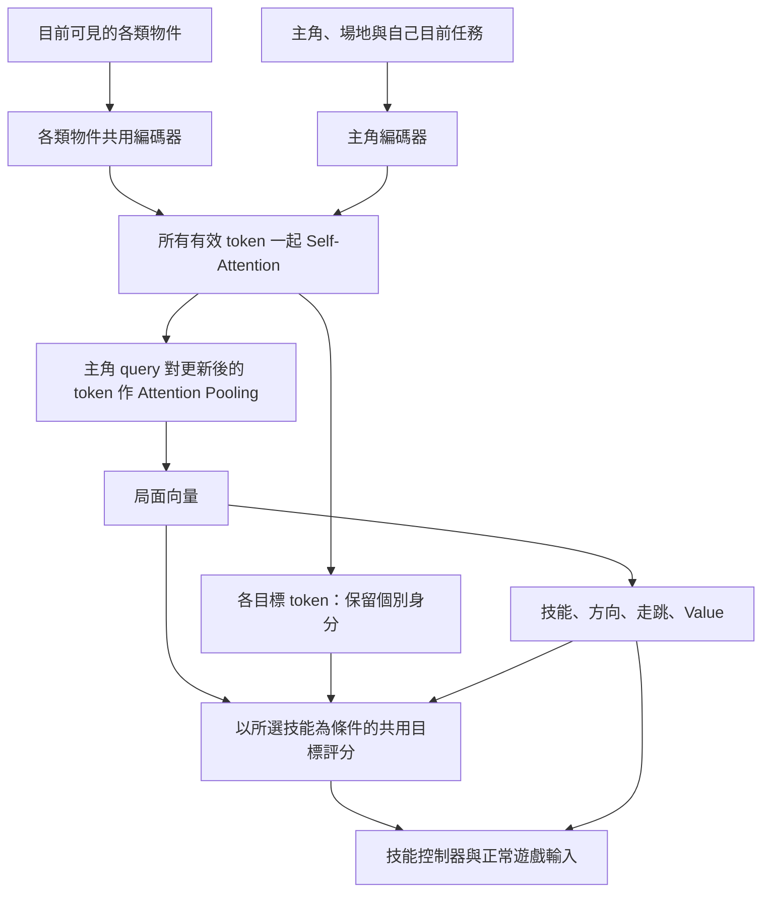

# NN 訓練：蕉片崛起生存階段

更新日期：2026-10-24。已實作 CPU NN／PPO、survival-only 訓練、固定 seeds 評估、checkpoint 續訓與開發模式每局自動 Replay。這是可執行的第一版訓練流程，不代表模型已學會過關。現有模擬介面見 [SIMULATION.md](SIMULATION.md)，現行玩法以 [GAMEPLAY.md](GAMEPLAY.md) 為準。

## 目標與訓練方式

第一階段只玩「蕉片崛起」的小兵生存階段，不進 Boss 戰。NN 讀取狀態並輸出操作，強化學習（RL）演算法根據遊玩結果調整 NN 權重。目前採 PPO-Clip；NN 與 RL 分別負責策略表示與學習方法，並非二選一。

提供輸入、動作與最終分數，仍需更新權重的方法。可用 RL 讓模型自行探索，也能用演化演算法搜尋權重；這個任務先選 PPO 作起點。現有 rule-based AI 作為比較基準，不必強迫 NN 模仿；若探索太慢，再考慮以玩家／規則 AI 示範預訓練，之後用 RL 繼續改善。

參考：[PPO 官方說明](https://spinningup.openai.com/en/latest/algorithms/ppo.html)。

## 觀察資訊的設計原則

**NN 應取得與玩家眼睛能看見、或從連續畫面辨識到的同等資訊；差別只在於 NN 直接從遊戲引擎取得結構化數值，不必自行辨識圖片。** 能從引擎讀取，不代表就應提供給策略；每個觀察欄位都必須能對應玩家當下可見的畫面、HUD 或可見歷史。

- 可提供 viewport 內可見物件的位置、高度、移動速度與方向、動畫狀態，以及畫面公開的血量、資源、蓄力與預警。飛行中的物件只要仍可見，就不應因在空中而排除其可見位置、高度與運動資訊；可依各類最近 k 個限制計算量。
- 不提供畫面外物件、隱藏的敵人目標、尚未公開的攻擊方向、未來落點、未抽出的 RNG 或其他引擎內部答案。離開畫面後不繼續更新其位置／速度，也不以隱藏世界狀態補足觀察。
- 攻擊蓄力資訊只能在對應的可見提示出現後提供；不得因內部計時已啟動而提前透露。既有蓄力倒數的有效條件見下文，新增倒數欄位也須檢查其畫面依據。
- 不額外提供畫面沒有顯示的精確預測，例如「剩幾秒著地」。目前高度與升降速度可提供，著地時機、攔截位置及是否值得跳踩，由 NN 自行學習推估；不由控制器替它作戰術判斷。
- 自己剛選的動作與目前執行中的任務屬於操作歷史，可提供給 NN。完整世界、未來軌跡或損血診斷可供模擬、測試與除錯使用，但必須與策略輸入分離；新增欄位時應測試隱藏資訊變動不會改變 NN 觀察。

## 觀察與操作

NN 讀取結構化狀態，不做圖片辨識。原始 observation 供模擬與規則 AI 使用，包含全場資訊；NN 編碼器先限制物件在目前邏輯 viewport 內，再分種類取最近 k 個。不提供尚未出現的隨機結果或未預告的未來位置。

| 類別 | 建議觀察 |
| --- | --- |
| 主角 | 位置、高度、垂直速度、血量、無敵／倒地狀態、上次操作 |
| 資源 | 牛奶能量、大絕能量、可用技能與冷卻 |
| 蕉片 | 相對位置、高度、相對主角高度、可見位置差估計的水平／垂直速度、估計有效標記、堆疊數、蓄力／跳躍／飛射狀態 |
| 牛奶相關 | 地上瓶位置、牛奶敵人的位置與狀態、已顯示的預警與彈體 |
| 場地 | 邊界距離、剩餘時間、viewport 尺寸、手機倍率 |

訓練使用 `sim/training.cjs` 的 `milk-skills-v5` 契約，共 3306 維，與保留供一般控制器使用的 156 維 `features()` 分開。主角與場地 32 維，尾端另加目前任務 10 維（欄位及時間參數見 GAMEPLAY.md）；最近 64 個蕉片各 18 維、64 個牛奶敵人各 13 維、12 個地上瓶各 4 維、128 個敵方彈體各 8 維、16 個已公開預警各 5 維、16 個香蕉串各 4 維、16 個蕉皮滑板各 4 維。每類先以遊戲相同投影篩選 viewport 內物件，再按與主角的地面 X／Y 歐氏距離由近到遠取最近 k 個；敵人等距時以 id 排序，並有存在標記，缺額補零。64 個蕉片與 64 個牛奶敵人的獨立名額可涵蓋現行生存階段 50 個敵人的容量，避免某一類擠掉另一類；畫面外物件一律不選入，也不占名額。判定採物件投影錨點：`screenX=W/2+x-player.x`、`screenY=H×0.52+(y-player.y)×0.72-z`，錨點須在 `[0,W]×[0,H]`，不設畫面外 margin；會考慮飛行高度與鏡頭移動，錨點剛出界但圖案仍局部可見時保守略過。位置／速度與狀態先正規化，所有值限制於 −5～5；包含上次實際底層操作。只讀取已存在物件，不提供下一次 RNG 結果。目前使用前饋網路，沒有循環記憶。舊 `milk-skills-v1`／`milk-survival-v2` 為 2784 維，`milk-skills-v2` 為 3168 維、`milk-skills-v3` 為 3232 維；`milk-skills-v4` 為 3296 維；v5 加入目前任務觀察與可重新決策的執行器，須開新 run，不能直接 resume 舊 checkpoint。歷史分數與 Replay 保留。

現有動作介面為 `{x, y, jump, jet, dash, surf}`：移動軸為 −1～1，其餘為布林要求。仍遵守原遊戲的能量、冷卻與倒地限制，不能直接修改世界；不把暫停、重新開始等選單操作交給模型。

`sim/motion.cjs` 從連續可見觀察估計敵人速度。每個有效物理步更新位置差，垂直速度的正負表示上升／下降；不讀取飛行終點、內部飛行進度、未來落點或 RNG。蕉片原本從軌跡端點算出的水平速度也改成可見位置差。兩類敵人各增加垂直速度、相對主角高度、估計有效標記；新出現、離開畫面後再進入、類型改變或 reset 後第一個樣本的速度為未知（0 且有效標記為 0），不沿用畫面外歷史。相同時間重讀觀察不會清掉已估計的速度。中局／突破盤面恢復時也只使用實際可見的歷史，不把前綴獎勵加入訓練。

`sim/telegraph.cjs` 統一定義可見攻擊警示的「是否蓄力＋距這次出手的剩餘秒數」：堆疊蕉片為下一片發射，大綠蕉為開始衝刺，大紅蕉為投出榴槤。僅在當前蓄力警示有效時提供；離開 viewport、受擊／倒地／擊退、恢復或尚未蓄力時旗標為 0、秒數為 0（占位，不是即將攻擊）。倒數假設本次動作不中斷，期間狀態改變可能延後或取消，不預告之後的 cooldown 或未來攻擊。目前 milk 訓練只接入堆疊蕉片，替換原累積計時欄位並加有效旗標；綠／紅蕉的共用計算與測試已備妥，尚未增加蕉皮關 NN 訓練或目標槽。

目前 NN 選擇「技能＋方向／目標＋取得方式」，由 `sim/skills.cjs` 的底層控制器執行正常遊戲輸入。每個重新決策點可選另一技能；重選同一技能、參數及目標身分會接續任務，達任務上限後必須重新開始。技能完成、失去目標、受傷／倒地／反彈亦會提早交回決策；內部控制仍定期重新讀取可見盤面，物理以原 60Hz 更新。技能表、持續時間與判定參數統一記錄在 [GAMEPLAY.md](GAMEPLAY.md)。

策略有四個分類輸出頭：技能、方向、目標、取得方式（走路／跳躍）。先抽技能，再按技能遮罩其他參數；不使用的參數固定為 0，不產生無意義的機率或梯度。只有可用資源及當前狀態允許的技能可選；接近及跳踩選可見敵人；牛奶瓶、香蕉串、滑板各有獨立取得技能，只能選對應類型的可見目標；滑板滿庫存時遮罩取得滑板技能。目標槽與觀察的相同分類、可見範圍及最近 k 排序對齊，0 表示無目標，缺額不可選；執行期間鎖定物件 id（無 id 的靜止物件用類型與位置），不因最近排序改變而換目標，離開可見／可編碼名額即停止追蹤，不使用畫面外位置。底層只負責執行被指定技能，不替 NN 挑攻擊／逃跑策略，不保證命中、不改碰撞或資源。選跳踩即嘗試正常起跳並朝目標移動；已在空中則直接修正移動，不再等距離足夠或升到固定安全高度，也不自動等待／攔截敵人落地。空中目標仍可選，是否值得出手由 NN 從可見高度與速度學習。

取得技能另選走路或跳躍：控制器只使用普通移動，跳躍參數提出一次原遊戲的起跳要求；已在空中只修正移動，不強制升降。接近目標時停下等落地，取得條件、庫存與碰撞均沿用遊戲。每次技能有時間上限，目標消失或受傷等中斷後可立即重新決策；不鎖到成功為止，也不自動選安全路線。具體參數只在 GAMEPLAY.md 維護。新增的滑板輸入與目標仍受最近 k／viewport 限制，已取得物件不列入可選目標。

PPO 保存收集當時的條件遮罩與聯合 log probability，更新時沿用相同遮罩；entropy／KL 以所選技能的有效參數分支計算。每筆資料代表一次技能選擇，reward 為該技能期間真正存活時間的總和，不再固定等於 0.1 秒。Monte Carlo 完整回報仍以秒為單位，gamma=1，變長技能不改變存活目標。舊 `actionFor`／`trainingEnvironment` 保留給底層輸入及真實盤面前綴測試，訓練與四場評估改用 `skillEnvironment`。Replay 仍只錄最後實際物理步操作，播放不需要技能控制器或 NN。

新增技能時須定義可開始條件、參數遮罩、控制器、完成／中斷與超時條件，並增加獨立場景測試；不要因單次死亡就加戰術。先區分選錯技能／參數與執行器失敗，再判斷現有能力是否真的無法表達所需行為。移動與等待保留作為組合出口。

## 物件編碼與 Attention 架構

新 run 預設使用 `entity-attention-v1`，維持原來的可見觀察契約；不加入預測軌跡或引擎未來資訊。同類物件共用編碼器，不同類型各用自己的編碼器，主角／場地／目前任務另編成主角 token。所有存在的 token 一起做 self-attention，再以主角作 query 對已更新的 token 作 attention pooling 形成局面；缺額不建立 token；不把「第幾近」當作位置嵌入。各層寬度、head 數與其他參數統一見 [GAMEPLAY.md](GAMEPLAY.md)。



目標評分不再使用固定槽位的獨立輸出 weights。每個可選目標以其更新後的 token，對照局面與已選技能評分；同一物件換槽位時，分數跟著物件移動，而非跟著槽位。技能先抽樣後才建立該技能的目標分數；PPO 依收集時的技能及遮罩重建相同聯合機率，梯度同時回傳到目標評分、Attention 與各類編碼器。Value 只讀局面，不受本次抽到哪個技能影響。

這是結構上的學習偏好，不保證已懂密集彈幕或能規劃未來。仍需比較固定評估 seeds、實際模擬秒數與訓練耗時；self-attention 計算量隨可見 token 數平方成長，不能只按參數數量或代數推估成本。保持原 top-k 與物件上限，不為了加速改遊戲難度。可用 `--architecture mlp` 保留平鋪 MLP 對照。新架構需開新 run，舊權重不自動遷移；已錄 Replay 仍可播放。

## Objective 與 episode 結束

最終目標：最大化跨不同 seeds 與策略抽樣的預期存活秒數，單場最多 60 秒。

`J(θ) = E[min(T死亡, 60)]`

每存活 Δt 秒給 reward = Δt；不折扣時累計 reward 等於存活時間。第一版不加擊殺、搶瓶、扣血或死亡的額外獎懲。設定 `survivalOnly:true` 後，會取代一般模擬的擊殺、血量與勝負 reward。PPO 訓練仍包含策略與價值估計等內部 loss，與這裡定義的任務目標不同。

- 死亡或有效遊戲時間達 60 秒，episode 結束；不啟動蕉巨戰。
- 開場動畫、暫停時間不計分。可跳過開場動畫加速訓練。
- 明確區分任務完成與訓練器提前截斷；60 秒是這個有限時域任務的真正終點，剩餘時間應列入觀察。
- 現有 CLI 的 `--seconds` 是包含演出的模擬時間上限，不等於這個訓練模式。
- 若只逃跑就能得到高分，屬於符合目標的策略。若日後需要鼓勵攻擊，另行定義任務，不偷偷混入獎勵。

評估使用未參與訓練的 seeds，至少看平均存活時間、撐滿 60 秒比例與較差場次表現；與不動、隨機操作及 rule-based AI 比較。目前先限定桌機配置訓練及評估，手機評估留待後續另開 run。

參考：[Gymnasium 的終止與截斷說明](https://gymnasium.farama.org/tutorials/gymnasium_basics/handling_time_limits/)。

## 訓練結果觀察工具

本機 [訓練觀察室](TRAINING_DASHBOARD.md) 已接上訓練器，每代評估後自動記錄曲線，保留初代；每批的平均存活只要創歷史新高即保存代表 Replay，不再要求顯著增幅（詳見訓練觀察室文件）。第一代代表尚未更新的隨機 NN，之後每代先收集 rollout、更新權重，再評估。

## 訓練流程與現有架構銜接

```sh
# Node >=22、Python 3；不需安裝額外 npm 或 Python ML 套件。
BANANA_AI_REPLAY=1 npm start
# 另一個 terminal：第一代評估初始權重，後續每代更新一次。
npm run training:nn -- --generations 10 --run-id milk-ppo-01 --curriculum-replay /absolute/path/breakthrough.json
# 預設為 Attention；可加 --architecture mlp 建立原平鋪 MLP 對照。
# --hidden 控制模型寬度；Attention 的寬度限制見 GAMEPLAY.md。
# 可加 --warm-start /absolute/path/best.json，沿用同架構／寬度／輸入契約的權重，另開 Adam。
# 續訓 10 代；保留原模型、Adam 狀態、隨機串流和設定。
npm run training:nn -- --resume .training/models/milk-ppo-01/latest.json --generations 10
```

開啟 <http://127.0.0.1:8893/training/> 即可看結果。`--workers 2` 可限制 CPU worker 數；`--directory /absolute/path` 或 `BANANA_TRAINING_DIR` 可指定資料目錄，server 必須使用同一路徑。`--help` 顯示入口；訓練設定及界線見 [GAMEPLAY.md](GAMEPLAY.md)。首輪可用 `--rollout 32 --epochs 2` 快速驗證管線，但較小樣本不代表足夠學習。

- `sim/attention.cjs`：物件編碼、有效 token 的 self-attention／殘差前饋、局面輸出與帶技能條件的共用目標評分；手寫解析反向傳播，由 PPO 端到端更新。
- `sim/ppo.cjs`：模型 factory、原 tanh MLP 對照、共用條件抽樣；PPO-Clip、熵項、完整 episode 的 Monte Carlo 回報、Adam、梯度裁剪與 KL 提早停止。沒有 GPU backend。梯度有有限差分測試。
- `sim/telegraph.cjs`：三種敵人當前可見蓄力的剩餘時間及有效旗標。
- `sim/item-metrics.cjs`：Node 專用事件計數，統計三種實際取物次數及噴射秒數；不把計數當 NN 輸入或獎勵。
- `sim/motion.cjs`：僅使用連續可見位置差的速度估計，離開畫面後清除歷史。
- `sim/skills.cjs`：技能目錄、各道具獨立取得技能、可見目標槽、技能／參數遮罩與有限時間的底層控制器。只讀取觀察，輸出正常遊戲輸入。
- `sim/curriculum.cjs`：開局與最佳突破終局前盤面各占相同 loss 比重；突破盤面從已驗證 Replay 取出並設定 HP；具體比例、時點及池大小見 GAMEPLAY.md。缺少盤面會失敗，不退回開局。內部 late 組鍵 `50` 表示突破類別，並非固定起始秒數。
- `sim/snapshot.cjs`：Node 專用完整世界快照編碼，保留共享引用與 Set／Map。建立後直接恢復，不反覆重演前綴；不更改正式遊戲與 Replay 來源雜湊。
- `sim/training-worker.cjs`：長駐 Node worker 各自擁有獨立 VM，載入正式遊戲；主程序按代批次傳送權重與收回經驗，不逐物理步啟動外部程序。訓練 episode 的 Replay 關閉；評估才錄代表場次。
- `scripts/train-nn.cjs`：收集完整 episode、更新、評估及寫入儀表板；兩份 rollout 從開局／最佳突破終局前盤面開始，按指定比重分配最低筆數。`--rollout` 代表最低總量的三分之一，具體預設、比重與配額見 [GAMEPLAY.md](GAMEPLAY.md)。額度以技能決策筆數計算；同一筆可能包含多個底層控制 tick，所以不能與舊按鍵訓練直接按筆數比較效率，應看模擬物理步／秒數與實際耗時。每組未達額就從同類起點重開；達額後仍跑到死亡或任務完成，最後一場不截斷。收集期間權重固定，worker 數只影響併行量。尾段增加筆數後，按各組實收筆數加權 policy、value、entropy loss 及 KL 統計，維持指定起點比重；advantage 標準化亦按相同比重計算。先比較不動、相同離散操作的隨機控制器、現有規則 AI；隨機基準也改為均勻選可用技能與有效參數。規則 AI 不是 NN 的模仿學習目標。
- gamma=1；每步 reward 就是有效時間差，累計等於存活秒數。每一場完成後往回累加實際 reward，得到每步的 Monte Carlo reward-to-go；value target 不包含 Critic 估計，原始 advantage=實際回報−當時 value。沒有 GAE、lambda 或截斷 bootstrap；Critic 仍作為降低策略梯度波動的 baseline，目標不含估計不代表單場樣本沒有隨機波動。價值 loss 的誤差以 60 秒為單位縮放，策略 advantage 加權標準化，沒有加入額外任務獎懲。更新後丟棄 rollout buffer。可變筆數及末尾不足的 minibatch 都會訓練，更新次數隨資料量改變。
- 每代快評固定四個未參與訓練的 seeds，全部使用桌機配置，使用固定且獨立的策略抽樣串流。新生成訓練 seeds 限低位區間，匯入舊突破可來自先前評估區間，本批新評估 seeds 與兩者分離。每代評估仍全部從 0 秒開始；輸出平均、最低、60 秒達成率及各階段實際耗時，另記錄各起點類別的最低／實收技能決策筆數、完成 episode 數、loss 比重、物理步數、技能使用次數、三種道具實際取得數與噴射秒數，以及 0～30／30～50／50～60 秒區段的資料筆數（按技能開始時刻歸類）（CLI 與 checkpoint 的 `training`，尚未加入儀表板欄位）；完整個別分數及每場 `evaluation.itemMetrics` 寫入 checkpoint，CLI 另列 `evaluationItemMetrics`；新增統計尚未加入儀表板欄位。另記錄真正扣血的原因及最近三次決策：`training.starts.*.damage` 為訓練彙總，checkpoint 的 `evaluation.damage` 與 CLI 的 `evaluationDamage` 含每場彙總與事件明細；格式、時間區段與清除規則見 GAMEPLAY.md。每代亦追加保存到該 run 的 `damage-history.jsonl`，不因 latest checkpoint 覆寫而遺失。診斷不進 NN 觀察或 reward，尚未新增儀表板欄位。不是以這四場直接做梯度更新。
- 模型放在 `.training/models/<runId>/`，維持 initial／quick-best／best／latest、baselines、starts 及 curriculum-probe 摘要，不保留每代權重。`quick-best.json` 隨四場快評新高更新；`best.json` 獨立依候選驗證平均更新，與 Replay 保存不綁定；舊門檻規則下曾未保存的新高，不會自動補回。checkpoint 包含權重、Adam、隨機狀態、來源、訓練程式雜湊與設定；原設定續訓須完全一致。改課程時另開 run；`--warm-start` 只載入相同來源／架構／輸入契約的權重，重新建立 Adam。新 run 必須提供 `--curriculum-replay`。Replay 的數量／容量配額另計，模型和快照池在其外。
- 不再建立固定中局課程；突破盤面只將 HP 設為指定值，其他狀態原樣保留，reward 從還原後開始計算。快照恢復不執行物理步，最後兩個可見觀察重建運動估計，保留前次輸入；固定步長、碰撞與物件量不變。匯入紀錄建立最佳單場基準；每代另跑獨立訓練試跑，只有單場秒數新高才替換整個突破池，下一代生效。
- 快評、候選驗證及最終測試使用互不重疊的 seeds，全部從 0 秒開始且不補血，任何評估 Replay 都不回流訓練；初始舊突破用過的 seeds 與本批評估分離。獨立訓練試跑可用來選課程，但不是額外評估成績。具體 seeds 與課程比重只在 GAMEPLAY.md 維護。
- Ctrl+C／SIGTERM 會在本代完成及儲存後停止。訓練與儀表板寫入不是跨檔案交易；若在寫入兩者之間強制 kill，可能留下 `pending-*`，此時不要覆寫既有代數，先保留該目錄並檢查最後紀錄。一般停止與正常續訓已支援。

初期幾代的曲線可能下降；這證明能執行更新，不代表已收斂。NN 已限制 viewport 內物件，仍使用精確的結構化狀態與自身／場地資訊，並非圖片辨識。未實作 RNN、模仿預訓練、GPU 或直接將 checkpoint 載入遊戲操控。檢視行為先透過 Replay，播放不需模型。更換目標或調參請另開 run，避免混合不可比較的成績。

## Replay 格式、容量與建議流程

現有 Replay 記錄 seed、viewport、手機倍率、來源版本、固定步長、壓縮操作序列與結果校驗；不錄影片或每幀所有敵人，播放不需原 NN。連續相同操作以維持幀數合併。需要相同遊戲來源版本，長期保存時應一起保留對應 commit。

依現有 JSON 格式合成五分鐘操作的容量估算（未壓縮，並非實際五分鐘存活測試）：

| 操作改變頻率 | 方向鍵式 | 連續搖桿式 |
| --- | ---: | ---: |
| 每秒 10 次 | 約 110 KB | 約 153 KB |
| 每秒 60 次 | 約 660 KB | 約 914 KB |

另一次規則 AI 實測為 47.15 秒、329 段操作，JSON 約 16 KB；不能當成所有場次的固定比例。JS 物件的記憶體占用會大於 JSON 檔。

開啟 AI／Replay 開發旗標時，瀏覽器每局自動暫存，已移除「記錄 Replay」勾選框；結束後決定是否下載。回主選單保留當局，真正開始新局才清除上局；暫停／繼續不清除。僅存記憶體，不自動上傳或寫硬碟，重新載入頁面會遺失未下載紀錄。旗標關閉時保持原來的手動流程，不建立 Replay；正式部署預設關閉。

開發旗標開啟時，一般手動操作與 AI 均經過 seeded RNG、固定步長與錄製管線。鍵盤／觸控將按下邊緣與持續狀態分開，暫停清空輸入並停止物理步；Replay 記錄實際送入模擬的操作。訓練的 rollout buffer（觀察、reward、機率等）與供觀看的 Replay 是不同資料，批次訓練不應永久保留所有歷史場次。


## 候選驗證與更新診斷

儀表板曲線與代表 Replay 延續每代快評，方便比較既有記錄。另以較大的固定驗證集挑選 `best.json`：初代、快評新高與固定代數間隔才加跑，降低每代成本，同時讓快評退步的模型仍有被驗證的機會。場次、間隔與 seeds 統一見 [GAMEPLAY.md](GAMEPLAY.md)。`validation-history.jsonl` 保留每次驗證、快評平均與是否入選；快評最佳另存 `quick-best.json`。驗證不更新 weights，不取代持續訓練的 latest，也不回流課程。

正常完成指定代數後，另用獨立測試集檢查驗證選出的模型，寫入 `test.json`；中斷後完成當代 checkpoint 即停，不額外測試。續訓完成時會重新測試當時最佳模型。測試只用於最後報告，若根據測試結果反覆調參，就應換新的測試 seeds，避免將測試集變成另一個驗證集。

`optimizer.diagnostics` 對更新後固定權重及完整舊 rollout 計算各條件 head 的 KL 總和、policy entropy、各 head 的有效選擇比例，以及 value 更新前後對真實 Monte Carlo 回報的 MAE、bias、explained variance。正規化 entropy 只統計該 head 有多個合法選項的資料，避免倒地等待造成假性低 entropy；沒有可選資料則為 null。`epochStats` 的 KL 是各 minibatch 在更新當時的數值，不能與最終整批 KL 混稱。診斷多花一次 forward，既有梯度、KL guard 及 learning rate 保持不變；新增欄位先保存於 CLI／checkpoint，未加入儀表板。

課程與訓練程式已變更，應另開 run。可用 `--warm-start` 載入相同架構／寬度／輸入契約的舊 Attention weights，重新建立 Adam；不能直接以舊 implementation digest 續訓。普通移動在倒地／受擊彈退時只剩中立方向，避免學到原控制器根本不執行的選擇，仍保留這些經驗訓練 value；可用的緊急技能維持原有選向。


## 九宮格區域 Attention 試作

`--architecture regions` 選用 `region-attention-v2`，原 `--architecture attention` 保留為對照及預設。輸入與短技能動作契約完全相同；九宮格是可訓練的觀察彙整，不是九個新動作，也不預先給安全答案。幾何、維度與參數數量見 [GAMEPLAY.md](GAMEPLAY.md)。

```text
可見物件 → 共用類別編碼器 → 物件 self-attention
                              ├→ 原整體局面向量 ──────────┐
                              ├→ 九個有畫面座標的區域池 ──┤
                              └→ 個別物件目標 key         │
                                           融合整體與九格 ←┘
                                                ↓
                            原技能／方向／走跳／Value 與目標 query
```

各區對所有 token 使用相同的關係 NN：串接物件向量與區域相對位置，得到 relation，再算 score 及 value 向量。每格獨立 softmax 彙整，沒有硬分格或跨格切換；區外子彈也可影響該區。區域 pooling 的 value 只是被加權的向量，不是 critic 的存活秒數預測。幾何位置固定了區域參考；是否學到有用的區域風險仍須用訓練與對照盤面檢驗，單元測試不代表已學會安全判斷。

```sh
# 另開實驗；不要以舊 Attention checkpoint 直接 resume 或 warm-start。
npm run training:nn -- --architecture regions --generations 10 --run-id milk-regions-01 --curriculum-replay /absolute/path/breakthrough.json
```

新增區域路徑以 PPO 的同一個 loss 端到端更新，沒有額外標籤、引擎預演、未來落點或人工路線。所有區域使用相同權重，融合時保留固定空間順序；個別物件目標仍保留。測試包含全參數數值梯度、區域幾何與可視性、物件順序不變性／目標等變性、格線連續性、空場景、PPO 更新、checkpoint 及真實 Replay 驗證。CLI 儀表板批次名稱會標為九宮格 Attention，尚未新增區域向量的 UI 視覺化。


九宮格 v2 額外讓每格知道「可行走面積比例」與「中心是否位於地圖內」，由原本已提供的四邊界距離和畫面投影計算；同時送入關係編碼與決策融合層，避免空白地圖外區域只能靠全局 Value 自行辨別。精確公式見 GAMEPLAY.md。區域中心在地圖內只是幾何上的可達，不保證移動途中安全；模型仍自行選方向。空場景也保留地形資訊，玩家跳起來不會令地圖邊界改變。v1 權重維度維持相容載入，v2 必須另開模型；不自動遷移舊權重或 Adam。測試增加四邊／角落、桌機／手機 viewport、跳躍高度不變性、地形進入兩條決策路徑與舊架構載入覆蓋。

目前課程採開局與最佳終局前起點兩組；比例、時間範圍及 HP 以 GAMEPLAY.md 為準。還原不額外給無敵，第一次真實扣血才按遊戲規則取得保護。新課程需另開 run，可 warm-start 同架構最佳權重；不改已啟動的舊批次設定。
